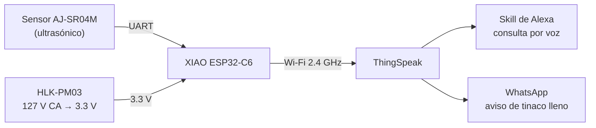
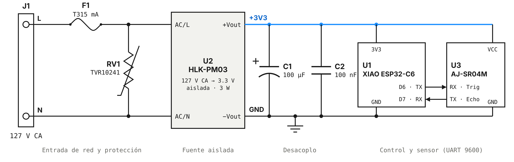

# RXT. TNK-1 — Monitor de nivel para tinaco

  

  
  
  

Monitor de nivel de agua para tinacos de azotea. Mide el nivel con un sensor ultrasónico a prueba de agua, publica el dato en la nube cada pocos segundos y te avisa por WhatsApp cuando el tinaco se llena. También puedes preguntarle a Alexa cuánta agua hay. No hace falta instalar ninguna app nueva.

Proyecto de hardware abierto de **REXTRONIX.**, hecho en Morelia, Michoacán, con piezas que se consiguen localmente.

---

## El problema

En muchas colonias de Morelia el agua llega por tandeo: se junta en la cisterna y una bomba la sube al tinaco. El tinaco no tiene ningún indicador, así que para saber cuándo apagar la bomba alguien tiene que subir a la azotea a revisar. Si la bomba se queda prendida de más, el agua se tira por el rebosadero; si se apaga antes de tiempo, te quedas sin agua hasta el siguiente tandeo.

## Cómo funciona

1. El sensor mide el tiempo que tarda el eco en regresar desde la superficie del agua: `d = v · t / 2`.
2. El XIAO ESP32-C6 convierte la distancia a porcentaje:
   `nivel (%) = 100 · (d_vacío − d) / (d_vacío − d_lleno)`
3. El nivel se publica en un canal de ThingSpeak.
4. Alexa lee el último dato del canal cuando le preguntas; al llegar a 97 % se manda el aviso «Tinaco lleno» por WhatsApp.

## Hardware

| Componente | Función |
|---|---|
| AJ-SR04M (modo 5, UART) | Sensor ultrasónico a prueba de agua |
| Seeed XIAO ESP32-C6 | Microcontrolador con Wi-Fi |
| Hi-Link HLK-PM03 | Fuente aislada 127 V CA → 3.3 V |
| Fusible lento T315 mA | Protección contra sobrecorriente |
| Varistor TVR10241 | Protección contra picos de voltaje |
| 100 µF + 100 nF | Desacoplo del riel de 3.3 V |
| Gabinete ABS Steren 85 × 85 × 50 mm | Gabinete para exterior, con prensaestopa |

El esquemático completo está en [`hardware/`](hardware/).

  

## Firmware

- Dispara una lectura del sensor (`0x01` por UART, 9600 baud) cada 0.5 s.
- Filtro de mediana de 7 muestras para eliminar ecos falsos y el oleaje del agua.
- Si no hay una lectura válida en 10 s, no envía nada.
- Watchdog de 30 s: si el programa se cuelga, el ESP32 se reinicia solo.
- Reconexión automática a Wi-Fi.
- LED de estado: 1 parpadeo = envío correcto, 3 = falló.

### Compilar

1. Instala el [Arduino IDE](https://www.arduino.cc/en/software) y el paquete de placas **esp32** de Espressif.
2. Selecciona la placa **XIAO_ESP32C6**.
3. Copia `firmware/secrets.example.h` como `firmware/secrets.h` y llena tu red Wi-Fi y tus claves de ThingSpeak.
4. Ajusta `D_VACIO` y `D_LLENO` a tu tinaco (ver abajo) y sube el código.

### Calibración

Mide con un flexómetro, desde el transductor:

- `d_vacío`: distancia al fondo del tinaco.
- `d_lleno`: distancia al nivel máximo de agua. Debe ser **de al menos 20 cm** (zona ciega del sensor).

## ⚠️ Seguridad

Este equipo se conecta a la red eléctrica de 127 V. Arma y prueba la etapa de potencia **sin conexión a la red**, no abras el gabinete mientras esté conectado y **nunca conectes el USB y la HLK-PM03 al mismo tiempo**: ambos alimentan el mismo pin de 3.3 V. Si no tienes experiencia con voltaje de red, pide ayuda a alguien que sí la tenga.

## Estado del proyecto

- [x] Medición y filtrado
- [x] Publicación en ThingSpeak
- [x] Consulta por voz con Alexa
- [x] Aviso por WhatsApp
- [x] Fuente de red con fusible y varistor
- [x] Prototipo en placa perforada dentro del gabinete
- [ ] PCB propia
- [ ] Filtro de entrada (capacitor X2 + choke de modo común)
- [ ] Compensación por temperatura

## Fotos

| Prototipo | Interior | Instalado |
|---|---|---|
|  |  |  |

## Licencia

- **Hardware** (`hardware/`): [CERN-OHL-W v2](hardware/LICENSE)
- **Firmware** (`firmware/`): [Mozilla Public License 2.0](firmware/LICENSE)

Puedes usarlo, modificarlo y venderlo. Si distribuyes una versión modificada, los cambios a estos archivos deben seguir abiertos.

## Autor

**Luis Enrique Madrigal Pintor** · REXTRONIX.
Ingeniería Electrónica, Instituto Tecnológico de Morelia
